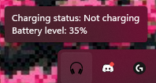

<div align="center">

# hyperx_ngenuity_open

**Open-source control app for HyperX wireless headsets — a lightweight alternative to NGENUITY.**

[English](#english) · [Русский](#русский)

</div>

> Unofficial project. Not affiliated with, endorsed or sponsored by HP Inc. or HyperX.
> HyperX and NGENUITY are trademarks of HP Inc., used only to describe compatible devices.

---

## English

Battery, mute, sidetone, Discord integration, automatic audio-device switching and a readable battery icon in the
system tray — in one small app, no NGENUITY required. Windows is the main target; Linux and macOS are supported
for the core features.



### Features

- **Battery & status** — level, charging state, wireless dongle online/offline.
- **Tray icon** — large readable digits (or compact digit mode), colors per state (normal / low / critical /
  charging / headset off), configurable thresholds, live preview in the settings.
- **Mute button** — standard, play/pause or smart modes (single / double / hold); sidetone button as play/pause.
- **Discord** — direct mute through local RPC (guided setup), keybind mode or both; optional Discord → headset sync.
- **Audio switching** — when the headset is switched off the system default output/input move to the devices you
  choose (e.g. another headset) and return to the HyperX when it is switched on. Running apps' streams are moved
  too, so music does not stay on a dead device. Works for the whole system, not only inside the app.
- **Voice announcements** for battery events with adjustable pause, multi-headset failover.
- **Logging** — log file always written next to the exe; optional console window ("Log to console" setting or
  `--console`).

### Supported devices

| Family | Models |
|---|---|
| Cloud II | Wireless (incl. DTS), Core Wireless |
| Cloud III | Wireless, S Wireless |
| Cloud Alpha | Wireless |
| Cloud Flight | Flight, Flight S |

Other models can be added from HID logs — open an issue with the **VID:PID** and the log.

### Install

Download the installer from [Releases](https://github.com/serejaishkin/hyperx_ngenuity_open/releases) and run it.
Config (`config.toml`), tray settings and the log live next to the exe
(default `%LocalAppData%\HyperHeadsetv2`).

**Linux:** copy `99-HyperHeadset.rules` to `/etc/udev/rules.d/`, reload udev and replug the dongle so the headset
can be opened without root.

### Build from source

Requirements: Rust (stable), Node.js, and for the installer `cargo install tauri-cli --version "^2"`.

```bash
git clone https://github.com/serejaishkin/hyperx_ngenuity_open.git
cd hyperx_ngenuity_open

./build_tauri_installer.sh        # Windows installer + exe -> ./release  (Git Bash)
cargo build --release             # egui build, binary `hyperx_ngenuity_open`
cd src-tauri && cargo tauri build # Tauri app only
```

> Use `build_tauri_installer.sh` for installers: plain `cargo build` does not produce an MSI/NSIS package.
> The version is shown in the window title and in the first log line (`Log started (vX.Y.Z)`).

### Project layout

| Path | Purpose |
|---|---|
| `src/` | core library + egui app: HID protocol, device logic, tray icons, audio switching |
| `src-tauri/`, `ui/` | Tauri 2 app and its web UI |
| `REVERSE_ENGINEERING/` | protocol notes |
| `installer/`, `HyperXSetup.iss` | installer assets |
| `archive/` | old docs and leftovers kept for reference |

### Reporting a problem

Attach the log file (next to the exe), your headset model and its VID:PID. Enable "Debug" in settings for
verbose HID output.

### Credits & license

Started as a fork of [HyperHeadset](https://github.com/LennardKittner/HyperHeadset) by Lennard Kittner (MIT);
now developed independently by Sergey Ishkin. MIT license — see [LICENSE](LICENSE) and
[THIRD_PARTY_LICENSES.txt](THIRD_PARTY_LICENSES.txt).

---

## Русский

Открытое приложение для управления беспроводными гарнитурами **HyperX** — лёгкая замена NGENUITY: батарея,
мьют, сайдтон, интеграция с Discord, автопереключение звука и читаемая иконка в трее.

### Возможности

- Уровень заряда, зарядка, статус донгла (онлайн/офлайн).
- Иконка в трее: крупные цифры или компактный режим, цвета по состояниям (норма / низкий / критический /
  зарядка / выключена), пороги, предпросмотр в настройках.
- Кнопка мьюта: обычный, play/pause или умный режим (клик / двойной / удержание).
- Discord: мьют через локальный RPC, режим хоткея или оба сразу; синхронизация Discord → гарнитура.
- Автопереключение звука **во всей системе**: гарнитуру выключил — вывод/ввод уходят на выбранные устройства
  (например, другие наушники), включил — возвращаются на HyperX. Звук запущенных приложений переносится тоже.
- Голосовые оповещения о батарее, лог-файл рядом с exe (консоль — опция «Лог в консоль» или `--console`).

### Установка

Скачайте установщик в [Releases](https://github.com/serejaishkin/hyperx_ngenuity_open/releases). Конфиг, настройки
трея и лог лежат рядом с exe (по умолчанию `%LocalAppData%\HyperHeadsetv2`).

### Сборка

```bash
./build_tauri_installer.sh   # установщик Windows -> ./release (Git Bash)
```

Нужны Rust, Node.js и `cargo install tauri-cli --version "^2"`. Версия видна в заголовке окна и в первой строке лога.

### Проблемы

Приложите лог, модель гарнитуры и VID:PID. Для подробного лога включите «Отладка» в настройках.

### Лицензия

MIT. Начинался как форк [HyperHeadset](https://github.com/LennardKittner/HyperHeadset) (Lennard Kittner),
сейчас развивается независимо. Проект не связан с HP Inc. и HyperX.
